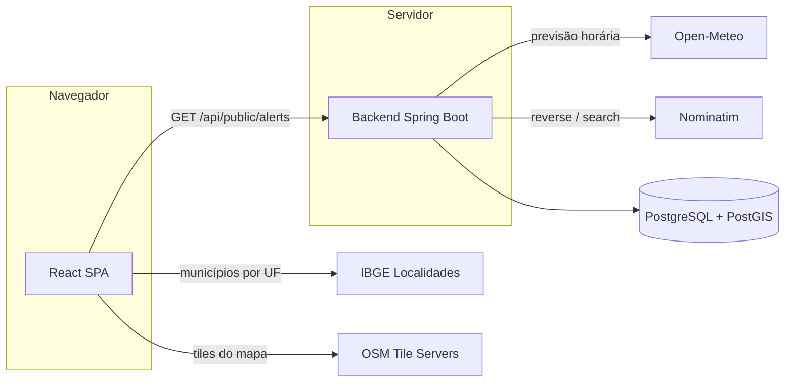

# APIs externas

Este documento descreve **todas as integrações com serviços de terceiros** usadas
pela ZELO: para que servem, como são chamadas, quais dados trafegam, como o
sistema se comporta quando elas falham e o que observar antes de colocar o
projeto em produção.

> Nenhuma das integrações atuais exige chave de API ou conta paga. Todas são
> `best effort`: a falha de um serviço externo degrada apenas a funcionalidade
> relacionada, nunca o restante da aplicação.

---

## 1. Resumo

| Serviço | Onde roda | Finalidade | Chave | Autenticação |
|---------|-----------|------------|-------|--------------|
| [Open-Meteo](https://open-meteo.com/) | Backend | Previsão do tempo e geração de alertas climáticos | Não | Nenhuma |
| [Nominatim / OpenStreetMap](https://nominatim.org/) | Backend | Geocodificação reversa (coordenada → município) e busca do centro de uma cidade | Não | `User-Agent` identificando a aplicação |
| [IBGE — Localidades](https://servicodados.ibge.gov.br/api/docs/localidades) | Frontend | Lista de municípios por UF para o seletor de cidade | Não | Nenhuma |
| [OpenStreetMap Tiles](https://wiki.openstreetmap.org/wiki/Tile_usage_policy) | Frontend (navegador) | Imagens do mapa base do Leaflet | Não | Nenhuma |



| Serviço | Se falhar… |
|---------|------------|
| Open-Meteo | O endpoint de alertas retorna apenas os alertas já persistidos e oficiais; o clima atual vem nulo. O app continua funcionando. |
| Nominatim | O ponto é salvo **sem cidade**; o centro de cidade usado em alertas cai para a média dos pontos já registrados e, sem isso, a operação é recusada com `400`. Nada mais é bloqueado. |
| IBGE | O seletor de cidade cai para digitação livre (texto). |
| Tiles do OSM | O mapa fica sem imagem de fundo, mas marcadores e dados continuam carregando. |

---

## 2. Open-Meteo (previsão do tempo)

### 2.1 Onde está no código

- Cliente: `backend/src/main/java/com/zelo/backend/service/WeatherAlertService.java`
- Configuração: `backend/src/main/resources/application.yml → alerts.rules.*`
- Endpoint público que dispara a consulta: `GET /api/public/alerts?lat&lng`

### 2.2 Chamada realizada

```
GET https://api.open-meteo.com/v1/forecast
    ?latitude={lat}
    &longitude={lng}
    &current=temperature_2m,precipitation,weathercode,windspeed_10m
    &hourly=precipitation,temperature_2m,windspeed_10m
    &forecast_days=2
    &timezone=auto
```

- **Uma única chamada** retorna o clima atual e a previsão horária de 2 dias.
- Não há chave, token ou cadastro. O serviço é gratuito para uso não comercial.
- Campos consumidos:
  - `current.temperature_2m`, `current.precipitation`, `current.weathercode`,
    `current.windspeed_10m`;
  - `hourly.time`, `hourly.precipitation`, `hourly.temperature_2m`,
    `hourly.windspeed_10m`.

### 2.3 Geração dos alertas

A geração é **preguiçosa**: acontece quando alguém chama `/api/public/alerts`.
Não existe job agendado. A janela avaliada são as **próximas 24 horas** a partir
da hora retornada pela API.

| Regra | Condição padrão | Severidade | Raio | Validade |
|-------|-----------------|------------|------|----------|
| `RAIN_EXTREME` | ≥ 20 mm em 1 h | `VERMELHO` | 15 km | 6 h |
| `RAIN_STRONG` | ≥ 7 mm em 1 h | `LARANJA` | 15 km | 6 h |
| `RAIN_ACCUMULATION` | ≥ 60 mm em 24 h | `AMARELO` | 20 km | 24 h |
| `HEAT_EXTREME` | ≥ 38 °C | `VERMELHO` | 25 km | 24 h |
| `HEAT_WAVE` | ≥ 35 °C | `LARANJA` | 25 km | 24 h |
| `COLD_WAVE` | ≤ 2 °C | `AMARELO` | 20 km | 24 h |
| `WIND_EXTREME` | ≥ 90 km/h | `VERMELHO` | 20 km | 12 h |
| `WIND_STRONG` | ≥ 60 km/h | `LARANJA` | 20 km | 12 h |

Regras de persistência:

- No máximo **3 alertas novos** por requisição.
- Deduplicação por `fingerprint = regra|lat|lon`, com latitude/longitude
  arredondadas para 2 casas (≈ 1 km). Enquanto houver um alerta ativo com o mesmo
  fingerprint, nada é inserido.
- Os limites são configuráveis por variável de ambiente (seção 6).

### 2.4 Limites e recomendações

- O plano gratuito é **não comercial** e tem limite de requisições por
  minuto/hora/dia (da ordem de 600/min, 5.000/h e 10.000/dia; confirme os valores
  atuais na documentação oficial). Uma chamada é feita por requisição de alertas,
  então um frontend com muitos acessos pode se aproximar do limite.
- Não há cache de previsão: duas chamadas seguidas ao endpoint geram duas
  chamadas à Open-Meteo. Para produção, considere cache de 5–10 minutos por
  coordenada aproximada.
- A aplicação **não envia identificação do usuário** — apenas a coordenada do
  mapa consultado.
- Licença dos dados: [CC BY 4.0](https://open-meteo.com/en/license). Mantenha a
  atribuição visível quando os dados forem exibidos publicamente.

---

## 3. Nominatim / OpenStreetMap (geocodificação)

### 3.1 Onde está no código

- Cliente: `backend/src/main/java/com/zelo/backend/service/ReverseGeocodingService.java`
- Usado por `IncidentService` (cidade do ponto), `WeatherAlertService` (centro
  de alerta oficial) e `MissingPersonService` (centro de desaparecido)
- Configuração: `application.yml → geocoding.base-url`
  (variável `GEOCODING_BASE_URL`)

### 3.2 Chamadas realizadas

**Coordenada → município** (ao registrar um ponto sem cidade):

```
GET {base-url}/reverse
    ?format=jsonv2
    &zoom=10
    &addressdetails=1
    &accept-language=pt-BR
    &lat={lat}
    &lon={lng}
```

**Cidade → centro do município** (ao publicar alerta oficial `LOCAL` ou aprovar
uma denúncia de desaparecido sem localização informada):

```
GET {base-url}/search
    ?format=jsonv2
    &limit=5
    &countrycodes=br
    &accept-language=pt-BR
    &q={cidade}, Brasil
```

O resultado do `search` é pontuado para preferir o município correto
(`municipality`, `city`, `town`, `village`, `administrative`, `county`) e evitar
bairros homônimos.

### 3.3 Política de uso e proteções implementadas

O Nominatim público exige:

| Exigência | Como a ZELO atende |
|-----------|--------------------|
| Máximo de ~1 requisição por segundo por IP | Throttle global de **1.100 ms** entre chamadas (`synchronized`) |
| `User-Agent` ou `Referer` identificando a aplicação | `User-Agent: ZELO-App/1.0 (zelo.apps.log.br)` |
| Uso moderado, sem autocomplete ou carga pesada | Chamadas pontuais; sem busca a cada tecla |
| Cachear resultados | Centro de cidade em cache em memória (`ConcurrentHashMap`) |
| Não usar o servidor público como produção de alto volume | Recomendação: instância própria ou provedor pago |

Outras proteções:

- `search` tenta **2 vezes** (a primeira pode esbarrar no rate limit).
- O intervalo é medido pelo último request efetivo, então duas cidades em
  sequência não disparam em paralelo.
- A URL é convertida em `URI` antes da chamada para não haver dupla codificação
  de caracteres como `%C3%A3`.

### 3.4 Falha e fallback

Qualquer erro (rede, timeout, HTTP, parse) é registrado como `WARN` e retorna
`null`:

- no registro do ponto, ele é salvo **sem cidade**;
- no alerta oficial local e na aprovação de desaparecido sem localização, o
  sistema usa como centro a **média dos pontos já registrados na cidade**; se não
  houver nenhum ponto, a operação é recusada com `400` e a mensagem "Não foi
  possível localizar a cidade".

O Nominatim **não** é consultado para exibir o mapa nem para buscar pontos.

---

## 4. IBGE — Localidades (frontend)

### 4.1 Onde está no código

- `frontend/src/services/ibge.ts`
- Consumido por `frontend/src/components/CityPicker.tsx` (perfil e painel
  administrativo).

### 4.2 Chamada realizada

```
GET https://servicodados.ibge.gov.br/api/v1/localidades/estados/{UF}/municipios?orderBy=nome
```

- Lista oficial e gratuita, com **CORS liberado** — por isso é chamada direto do
  navegador, sem passar pelo backend.
- As 27 UFs ficam **embutidas** no código; só os municípios vêm da rede.
- Cache em memória por UF durante a sessão (a lista não muda).
- Timeout de **10 s**.
- Se a rede falhar, o componente permite digitar a cidade manualmente. O objetivo
  do seletor é evitar grafias divergentes que quebrariam o RBAC por cidade
  (comparação por texto).

---

## 5. OpenStreetMap Tiles (mapa base)

- `frontend/src/components/MapView.tsx` usa:
  `https://{s}.tile.openstreetmap.org/{z}/{x}/{y}.png`
- A atribuição `© OpenStreetMap contributors` é exibida no mapa.
- Cada tile é uma requisição feita **pelo navegador do usuário** aos servidores do
  OSM. Isso expõe o IP e a região visualizada ao provedor.

### 5.1 Limitações importantes

- A [política de uso de tiles do OSM](https://operations.osmfoundation.org/policies/tiles/)
  **não permite** uso intenso ou produção de alto volume sem autorização.
- Não há SLA, e o serviço pode bloquear clientes que abusem.
- Para produção, use **servidor de tiles próprio** (ex.: `tileserver-gl`,
  OpenMapTiles) ou um provedor (MapTiler, Mapbox, Stadia, Thunderforest).
- A URL do tile está fixa no componente; para trocar de provedor, extraia-a para
  uma variável de ambiente do build (`VITE_TILE_URL`) e inclua a atribuição
  correspondente.

---

## 6. Configuração e variáveis de ambiente

| Variável | Padrão | Serviço | Descrição |
|----------|--------|---------|-----------|
| `GEOCODING_BASE_URL` | `https://nominatim.openstreetmap.org` | Nominatim | Base da geocodificação (permite instância própria) |
| `alerts.rules.rain-strong-mm` | `7` | Open-Meteo | Limite de chuva forte (mm/h) |
| `alerts.rules.rain-extreme-mm` | `20` | Open-Meteo | Limite de chuva extrema (mm/h) |
| `alerts.rules.rain-accumulation-mm` | `60` | Open-Meteo | Acumulado em 24 h (mm) |
| `alerts.rules.heat-c` | `35` | Open-Meteo | Onda de calor (°C) |
| `alerts.rules.heat-extreme-c` | `38` | Open-Meteo | Calor extremo (°C) |
| `alerts.rules.cold-c` | `2` | Open-Meteo | Frio/geada (°C) |
| `alerts.rules.wind-strong-kmh` | `60` | Open-Meteo | Ventos intensos (km/h) |
| `alerts.rules.wind-extreme-kmh` | `90` | Open-Meteo | Ventos fortes (km/h) |

> As variáveis de `alerts.rules` não estão expostas como `UPPER_SNAKE_CASE` no
> `application.yml`; para sobrescrever no ambiente, use a forma
> `ALERTS_RULES_RAIN_STRONG_MM`, etc. (relaxed binding do Spring Boot).

Não há chave de API para nenhum dos serviços. Nenhum segredo precisa ser
versionado.

---

## 7. Resiliência

| Aspecto | Situação atual |
|---------|----------------|
| Timeouts | O bean `RestTemplate` é `new RestTemplate()`, **sem timeouts explícitos** — recomenda-se configurar `connectTimeout`/`readTimeout` (ex.: 3 s / 10 s) |
| Retry | Open-Meteo: nenhuma tentativa extra. Nominatim `search`: 2 tentativas |
| Circuit breaker | Não implementado |
| Cache | Nominatim: centro de cidade em memória. Open-Meteo: nenhum |
| Logs | Nominatim registra `WARN`; Open-Meteo falha em silêncio (retorna `null`) |
| Bloqueio do usuário | Nunca — todas as falhas são absorvidas |

### Evoluções recomendadas

1. Configurar timeouts no `RestTemplate` (ou usar `RestClient`/`WebClient`).
2. Adicionar cache com TTL para a previsão (5–10 min por coordenada arredondada).
3. Adicionar resiliência (Resilience4j) com circuit breaker e backoff.
4. Expor métricas de falha por integração (Micrometer/Actuator).
5. Trocar o Nominatim público por instância própria ou provedor com SLA.
6. Externalizar a URL dos tiles do mapa.

---

## 8. Privacidade e LGPD

| Dado enviado | Destino | Necessário? | Observação |
|--------------|---------|-------------|------------|
| Coordenada do mapa (lat/lng) | Open-Meteo | Sim | Não identifica o usuário; revela a região consultada |
| Coordenada do ponto ou nome da cidade | Nominatim | Sim | Revela a localização do ponto/ocorrência |
| Sigla da UF | IBGE | Sim | Dado público, não pessoal |
| IP + tiles visualizados | Servidores de tiles do OSM | Sim | Feito pelo navegador, fora do controle do backend |

Recomendações:

- Declarar na **Política de Privacidade** que coordenadas são enviadas a
  Open-Meteo, Nominatim e ao provedor de tiles.
- Não enviar nome, e-mail, CPF ou qualquer identificador do usuário a esses
  serviços — o código atual não envia.
- Para operação real, prefira instâncias próprias ou contratos com operadores que
  ofereçam garantias de tratamento.
- Consulte também [seguranca-e-lgpd.md](seguranca-e-lgpd.md).

---

## 9. Como testar as integrações

### Open-Meteo

```bash
curl "https://api.open-meteo.com/v1/forecast?latitude=-23.55&longitude=-46.63&current=temperature_2m,precipitation,weathercode,windspeed_10m&hourly=precipitation,temperature_2m,windspeed_10m&forecast_days=2&timezone=auto"
```

### Nominatim

```bash
curl -H "User-Agent: ZELO-App/1.0 (teste local)" \
  "https://nominatim.openstreetmap.org/reverse?format=jsonv2&zoom=10&addressdetails=1&accept-language=pt-BR&lat=-23.55&lon=-46.63"
```

### IBGE

```bash
curl "https://servicodados.ibge.gov.br/api/v1/localidades/estados/SP/municipios?orderBy=nome"
```

### Pela aplicação

1. Suba o backend e o frontend.
2. Abra o mapa e confirme que os tiles carregam.
3. Registre um ponto sem informar cidade e verifique se ela foi preenchida.
4. Abra `/perfil` e confirme que o seletor de cidade lista municípios do IBGE.
5. Chame `GET /api/public/alerts?lat=-23.55&lng=-46.63` e confira o clima atual e
   os alertas.
6. Derrube a rede (ou use uma URL inválida em `GEOCODING_BASE_URL`) e confirme
   que o cadastro de ponto continua funcionando sem cidade.

---

## 10. Checklist para adicionar uma nova API externa

- [ ] A chamada fica em um `service` dedicado, com URL e limites configuráveis.
- [ ] Há timeout explícito e tratamento de falha com fallback definido.
- [ ] A falha não bloqueia o fluxo principal.
- [ ] A política de uso do provedor foi lida (rate limit, atribuição, licença).
- [ ] Segredos ficam em variáveis de ambiente, nunca no repositório.
- [ ] Está claro **quais dados** saem do sistema e para quem.
- [ ] A integração foi registrada neste documento e na Política de Privacidade.
- [ ] Existe teste manual (ou automatizado) do caminho de sucesso e do fallback.
