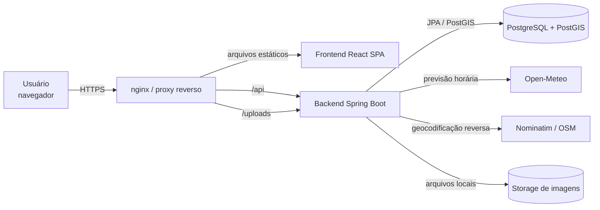
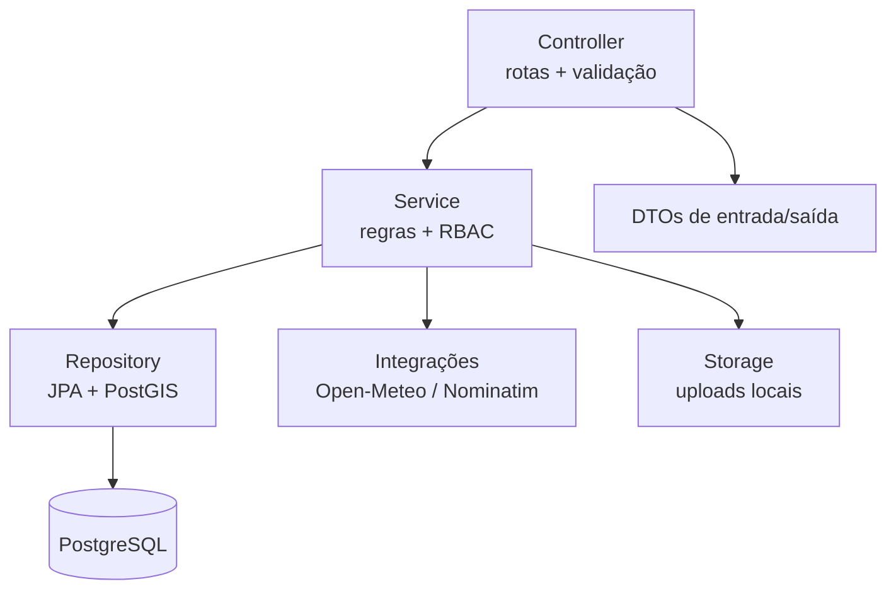
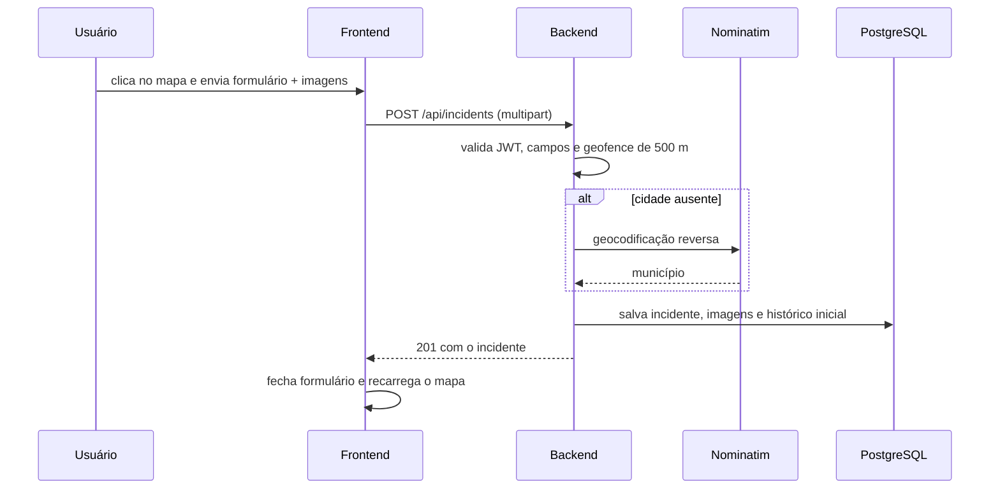
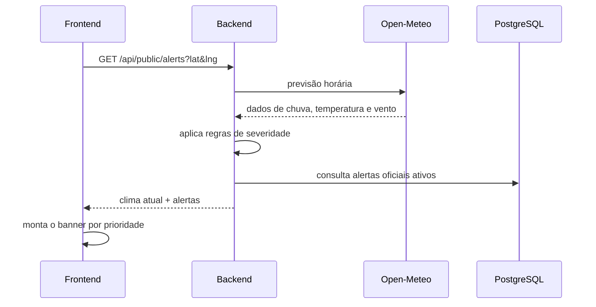
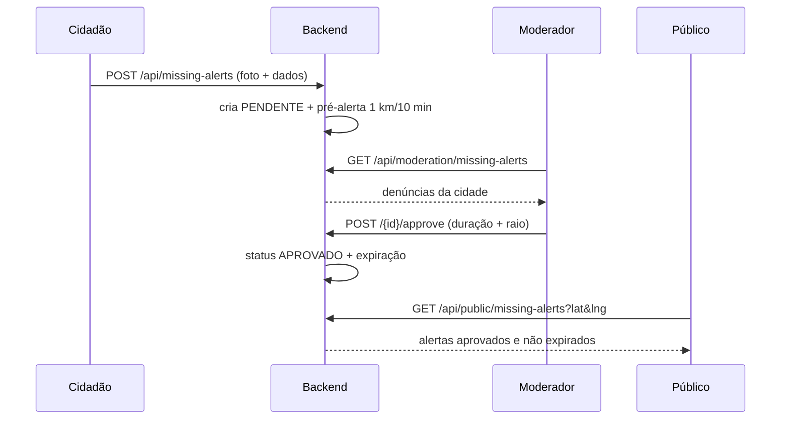
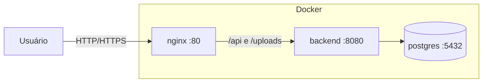

# Arquitetura

## 1. Visão geral

A ZELO é uma aplicação web dividida em três blocos principais:

- **Frontend SPA** em React/TypeScript, servido como arquivos estáticos.
- **Backend REST** em Spring Boot, responsável por regras de negócio,
  autenticação e persistência.
- **PostgreSQL + PostGIS**, responsável pelos dados relacionais e geoespaciais.

O frontend conversa com o backend por HTTP/JSON em `/api`. Em produção, um proxy
reverso (nginx) serve o SPA, encaminha `/api` e `/uploads` para o backend e
garante o fallback de rotas do React.



## 2. Componentes

| Componente | Responsabilidade |
|------------|------------------|
| **Frontend** | Interface, mapa, formulários, modais, roteamento e estado da sessão |
| **nginx** | Entrega do SPA, fallback de rotas, proxy de API/uploads e limite de upload |
| **Backend** | API REST, RBAC, validações, regras de negócio e integrações externas |
| **PostgreSQL/PostGIS** | Persistência relacional e consultas por proximidade |
| **Storage local** | Imagens de ocorrências e fotos de desaparecidos |
| **Open-Meteo** | Fonte da previsão horária usada pelo motor de alertas |
| **Nominatim** | Geocodificação reversa de coordenada para município |
| **GitHub Actions** | Build e publicação do frontend (GitHub Pages) |

## 3. Arquitetura do frontend

O frontend segue uma organização por responsabilidade:

```
src/
├─ api.ts          # cliente Axios + endpoints
├─ types.ts        # DTOs compartilhados
├─ router.ts       # rotas com History API
├─ App.tsx         # estado global e orquestração
├─ components/     # telas e componentes
├─ hooks/          # comportamentos reutilizáveis
└─ services/       # integrações externas (IBGE)
```

Características:

- **Mapa como tela-base:** os demais painéis são overlays derivados da rota.
- **Estado centralizado em `App.tsx`:** sessão, dados do mapa, filtros e modais.
- **Roteamento sem dependência extra:** `pushState`/`popstate` com fallback para
  `/` e navegação `back()`.
- **Tema centralizado:** Tailwind com paleta ZELO e classes compartilhadas em
  `index.css`.
- **Camadas de z-index documentadas:** evitam conflito com o Leaflet.

Detalhes em [frontend.md](frontend.md).

## 4. Arquitetura do backend

O backend segue a separação em camadas do Spring Boot:



| Camada | Conteúdo |
|--------|----------|
| `controller` | Endpoints REST, validação de entrada e anotações OpenAPI |
| `service` | Regras de negócio, RBAC por cidade, integrações e transações |
| `repository` | Consultas JPA e consultas espaciais |
| `entity` | Modelo de domínio persistido |
| `dto` | Contratos de entrada/saída (entidades não são expostas) |
| `config` | Segurança, JWT, CORS, OpenAPI, storage e inicialização |
| `exception` | Exceções de domínio e tratamento centralizado |

Detalhes em [backend.md](backend.md).

## 5. Fluxos principais

### 5.1 Registro de ponto crítico



### 5.2 Consulta de alertas



### 5.3 Moderação de pessoa desaparecida



## 6. Implantação

### 6.1 Containers



- O frontend é compilado em um estágio Node e servido pelo nginx.
- O backend é compilado com Maven e executado em JRE 21 com usuário não-root.
- O banco usa a imagem PostGIS e volume persistente.
- O `nginx.conf` faz `try_files ... /index.html` para as rotas do React.

### 6.2 GitHub Pages

O workflow `.github/workflows/deploy.yml` compila o frontend e publica `dist/` no
GitHub Pages a cada push na `main`.

> **Atenção:** GitHub Pages não aplica fallback de SPA. Links diretos como
> `/login` podem retornar 404 nesse ambiente. Para suportar todas as rotas, use
> a implantação com nginx/Docker ou adicione um `404.html` que redirecione para
> `index.html`.

## 7. Decisões arquiteturais

As principais decisões estão registradas em
[decisoes-tecnicas.md](decisoes-tecnicas.md). Resumo:

- SPA React + TypeScript com Vite.
- Tailwind CSS com paleta customizada.
- Leaflet para mapa e clusters.
- Roteador próprio com History API.
- Axios com interceptors para JWT e tratamento de 401.
- Spring Boot 3.3 + Java 21.
- PostgreSQL + PostGIS para geolocalização.
- JWT stateless e BCrypt.
- Armazenamento local de imagens com URLs relativas.
- OpenAPI/Swagger para documentação viva da API.
- Docker multi-stage para frontend e backend.

## 8. Limitações e evoluções recomendadas

| Limitação | Evolução recomendada |
|-----------|----------------------|
| Schema criado por `ddl-auto=update` | Adotar Flyway ou Liquibase |
| Storage local de imagens | Migrar para object storage (S3/MinIO) |
| Sem testes automatizados no backend | Criar testes de integração com Testcontainers |
| Sem notificações push | Adicionar Web Push ou e-mail |
| Sem rate limiting explícito | Adicionar limite por IP/usuário no gateway |
| GitHub Pages sem fallback de SPA | Usar nginx ou configurar `404.html` |
