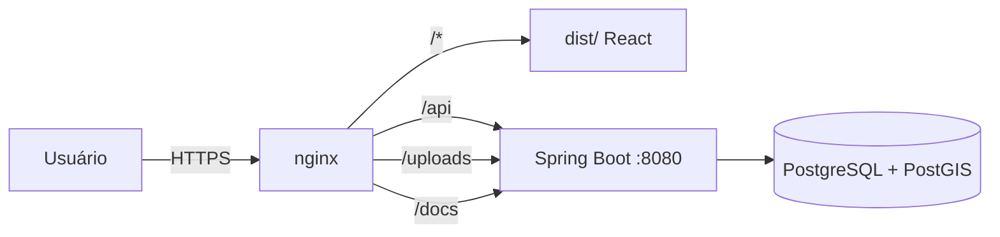

# Deploy

Este documento descreve as formas de publicação da ZELO, o pipeline existente e
as recomendações de operação.

---

## 1. Visão geral

A aplicação tem três artefatos:

| Artefato | Como é publicado |
|----------|------------------|
| Frontend | Arquivos estáticos em nginx ou GitHub Pages |
| Backend | Container Spring Boot atrás de proxy reverso |
| Banco | PostgreSQL + PostGIS com volume persistente |

A topologia recomendada mantém **frontend e backend no mesmo domínio**, com o
nginx servindo o SPA e encaminhando `/api`, `/uploads` e `/docs` para o backend.
Isso evita CORS e mantém as URLs de imagem relativas.



---

## 2. Backend em container

```bash
cd backend
docker build -t zelo-backend .
```

Variáveis mínimas de produção:

| Variável | Obrigatória | Observação |
|----------|-------------|------------|
| `DB_URL` | Sim | Aponta para o PostgreSQL |
| `DB_USER` | Sim | Usuário dedicado |
| `DB_PASSWORD` | Sim | Use segredo do ambiente |
| `JWT_SECRET` | Sim | ≥ 32 bytes, aleatório e secreto |
| `APP_CORS_ALLOWEDORIGINS` | Sim | Domínio público do frontend |
| `STORAGE_LOCAL_PATH` | Recomendada | Monte um volume persistente |
| `PUBLIC_BASE_URL` | Opcional | Base absoluta das imagens |

```bash
docker run -d --name zelo-backend \
  -p 8080:8080 \
  -e DB_URL="jdbc:postgresql://db:5432/zelo_db" \
  -e DB_USER=zelo_user \
  -e DB_PASSWORD="$DB_PASSWORD" \
  -e JWT_SECRET="$JWT_SECRET" \
  -e APP_CORS_ALLOWEDORIGINS="https://zelo.exemplo.org" \
  -v /srv/zelo/uploads:/app/uploads \
  zelo-backend
```

A imagem roda com usuário não-root (UID 1001).

### Healthcheck sugerido

O backend não expõe endpoint de health dedicado. Para monitoração, use uma rota
pública leve, como `GET /api/public/alerts?lat=&lng=`, ou adicione
`spring-boot-starter-actuator` e libere `/actuator/health`.

---

## 3. Frontend com nginx

```bash
cd frontend
docker build -t zelo-frontend .
docker run -d --name zelo-frontend -p 80:80 zelo-frontend
```

O `nginx.conf`:

- serve `dist/` com fallback de SPA (`try_files $uri $uri/ /index.html`);
- limita o corpo da requisição a 30 MB;
- encaminha `/api/` para `http://backend:8080`;
- encaminha `/uploads/`, `/docs`, `/swagger-ui/`, `/v3/api-docs` e `/webjars/`;
- adiciona cache de 7 dias para uploads.

> O nome `backend` no `proxy_pass` precisa resolver na rede Docker. Use
> `--network` com `--network-alias backend` ou ajuste o `nginx.conf`.

### HTTPS

Termine TLS em um proxy externo (Caddy, Traefik, nginx de borda ou load balancer)
e encaminhe para o nginx do frontend. Repasse `X-Forwarded-Proto` e
`X-Forwarded-For`.

---

## 4. GitHub Pages (workflow existente)

O arquivo `.github/workflows/deploy.yml`:

- dispara em push na `main` e por `workflow_dispatch`;
- instala Node 22 e roda `npm ci` em `frontend/`;
- roda `npm run build`;
- publica `frontend/dist` no GitHub Pages.

### Limitações

- **Sem backend**: o Pages serve apenas estáticos. As chamadas `/api` precisam
  apontar para um backend publicado em outro domínio, o que hoje não está
  configurado no código (a base é relativa).
- **Sem fallback de SPA**: o Pages não reescreve rotas para `index.html`. Links
  diretos como `/login` podem retornar **404**. Alternativas: publicar com nginx
  ou adicionar um `404.html` que redirecione para `index.html`.
- **Sem segredos**: não coloque tokens no workflow.

Para uma demonstração somente do frontend, é possível usar o Pages; para o produto
completo, prefira a implantação com nginx + backend.

---

## 5. Pipeline de CI recomendado

O repositório ainda não possui CI de testes. Sugestão de evolução:

```yaml
name: CI

on:
  pull_request:
  push:
    branches: [main]

jobs:
  frontend:
    runs-on: ubuntu-latest
    defaults:
      run:
        working-directory: frontend
    steps:
      - uses: actions/checkout@v4
      - uses: actions/setup-node@v4
        with:
          node-version: 22
          cache: npm
          cache-dependency-path: frontend/package-lock.json
      - run: npm ci
      - run: npm run test:filter
      - run: npm run build

  backend:
    runs-on: ubuntu-latest
    defaults:
      run:
        working-directory: backend
    steps:
      - uses: actions/checkout@v4
      - uses: actions/setup-java@v4
        with:
          distribution: temurin
          java-version: 21
          cache: maven
      - run: mvn -B verify
```

---

## 6. Banco em produção

- Use PostgreSQL 16+ com PostGIS.
- Crie um usuário de aplicação sem privilégios de superusuário.
- Configure backup automático e teste a restauração.
- Monitore conexões e crescimento das tabelas de incidentes e uploads.
- **Substitua `ddl-auto=update` por migrações versionadas** (Flyway/Liquibase)
  antes de evoluir o schema em produção.
- Habilite TLS na conexão com o banco quando o servidor estiver em outra máquina.

### Backup sugerido

```bash
pg_dump -Fc -h localhost -U zelo_user zelo_db > zelo_$(date +%F).dump
pg_restore -h localhost -U zelo_user -d zelo_db zelo_2026-11-11.dump
```

Inclua o diretório de uploads no backup (ou migre para object storage).

---

## 7. Checklist de publicação

- [ ] `JWT_SECRET` forte e fora do repositório.
- [ ] `DB_PASSWORD` e demais segredos via ambiente/cofre.
- [ ] `APP_CORS_ALLOWEDORIGINS` com o domínio real.
- [ ] HTTPS configurado no proxy de borda.
- [ ] Volume persistente para `/app/uploads`.
- [ ] Backup do banco e dos uploads agendado.
- [ ] `ddl-auto` revisado (idealmente migrações).
- [ ] Frontend com fallback de SPA funcionando.
- [ ] `/docs` protegido ou desabilitado, se não for público.
- [ ] Logs sem dados pessoais e sem tokens.
- [ ] Monitoração de disponibilidade e disco.

---

## 8. Rollback

1. Mantenha a imagem anterior identificada por tag (`zelo-backend:2026-11-11`).
2. Em caso de falha, suba o container com a tag anterior.
3. Restaure o banco apenas se a migração for incompatível — prefira mudanças
   retrocompatíveis.
4. Verifique `/api/public/alerts` e a abertura do SPA após o rollback.

---

## 9. Operação

| Tarefa | Como |
|--------|------|
| Ver logs | `docker logs -f zelo-backend` |
| Reiniciar | `docker restart zelo-backend` |
| Atualizar | rebuild da imagem + `docker rm -f` + `docker run` |
| Espaço em disco | monitore o volume de uploads e o banco |
| Alertas climáticos | dependem do Open-Meteo; falhas não derrubam a API |
| Geocodificação | dependem do Nominatim; falha mantém o ponto sem cidade |
| APIs externas | ver [apis-externas.md](apis-externas.md) para limites, cache e fallback |

Nunca inclua IPs internos, senhas ou tokens em issues, prints ou documentos do
repositório.
