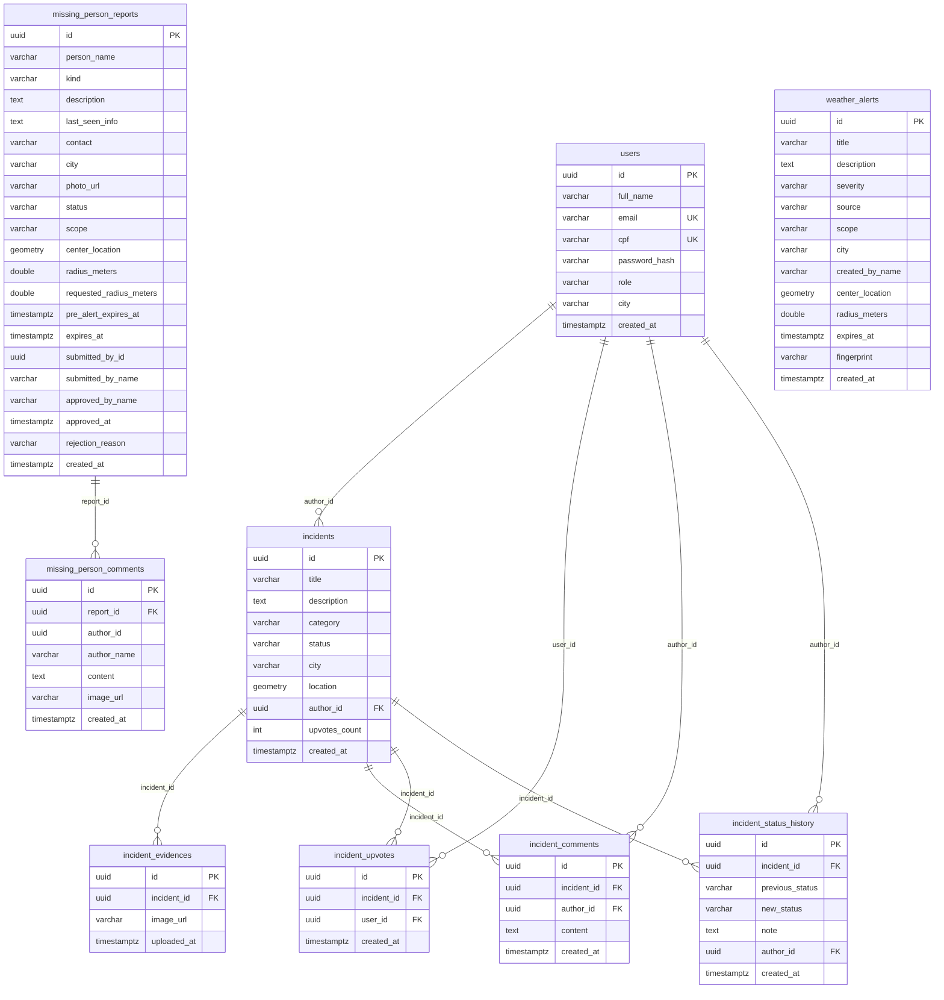

# Modelo de dados

O banco é **PostgreSQL com PostGIS**. O schema é criado e atualizado pelo
Hibernate (`spring.jpa.hibernate.ddl-auto=update`), a partir das entidades JPA em
`backend/src/main/java/com/zelo/backend/entity`.

> **Recomendação:** para produção, substituir `ddl-auto=update` por migrações
> versionadas (Flyway ou Liquibase).

---

## 1. Diagrama entidade-relacionamento



---

## 2. Tabelas

### 2.1 `users`

Usuários da plataforma e papéis de acesso.

| Coluna | Tipo | Restrições | Observação |
|--------|------|------------|------------|
| `id` | `uuid` | PK | Gerado pelo Hibernate |
| `full_name` | `varchar` | NOT NULL | Nome completo |
| `email` | `varchar` | NOT NULL, UNIQUE | Login |
| `cpf` | `varchar(11)` | NOT NULL, UNIQUE | Apenas dígitos |
| `password_hash` | `varchar` | — | BCrypt; nunca exposto |
| `role` | `varchar` | NOT NULL | `USER`, `FISCAL`, `GESTOR`, `ROOT` |
| `city` | `varchar` | — | Cidade de atuação no RBAC |
| `created_at` | `timestamptz` | — | Preenchido no `@PrePersist` |

### 2.2 `incidents`

Pontos críticos de infraestrutura urbana.

| Coluna | Tipo | Restrições | Observação |
|--------|------|------------|------------|
| `id` | `uuid` | PK | — |
| `title` | `varchar` | NOT NULL | Título curto |
| `description` | `text` | — | Descrição livre |
| `category` | `varchar` | NOT NULL | Enum `IncidentCategory` |
| `status` | `varchar` | NOT NULL | Enum `IncidentStatus` |
| `city` | `varchar` | — | Resolvida por geocodificação reversa |
| `location` | `geometry(Point, 4326)` | — | Coordenada do problema |
| `author_id` | `uuid` | NOT NULL, FK → `users.id` | Autor |
| `upvotes_count` | `int` | NOT NULL | Contador desnormalizado |
| `created_at` | `timestamptz` | — | — |

Relações: `evidences`, `comments` e `statusHistory` usam cascade
`ALL` + `orphanRemoval`, ou seja, são removidos junto com o incidente.

### 2.3 `incident_evidences`

Imagens de evidência do ponto crítico.

| Coluna | Tipo | Restrições |
|--------|------|------------|
| `id` | `uuid` | PK |
| `incident_id` | `uuid` | NOT NULL, FK → `incidents.id` |
| `image_url` | `varchar` | NOT NULL |
| `uploaded_at` | `timestamptz` | — |

### 2.4 `incident_comments`

Comentários dos usuários em um ponto crítico.

| Coluna | Tipo | Restrições |
|--------|------|------------|
| `id` | `uuid` | PK |
| `incident_id` | `uuid` | NOT NULL, FK → `incidents.id` |
| `author_id` | `uuid` | FK → `users.id` |
| `content` | `text` | NOT NULL |
| `created_at` | `timestamptz` | — |

### 2.5 `incident_upvotes`

Confirmações comunitárias. A constraint única garante **no máximo uma
confirmação por usuário por incidente**.

| Coluna | Tipo | Restrições |
|--------|------|------------|
| `id` | `uuid` | PK |
| `incident_id` | `uuid` | NOT NULL, FK → `incidents.id` |
| `user_id` | `uuid` | NOT NULL, FK → `users.id` |
| `created_at` | `timestamptz` | — |

**Constraint:** `UNIQUE (incident_id, user_id)`.

### 2.6 `incident_status_history`

Linha do tempo de status e notas. É o registro de auditoria do ciclo de vida do
ponto crítico.

| Coluna | Tipo | Restrições |
|--------|------|------------|
| `id` | `uuid` | PK |
| `incident_id` | `uuid` | NOT NULL, FK → `incidents.id` |
| `previous_status` | `varchar` | — |
| `new_status` | `varchar` | NOT NULL |
| `note` | `text` | — |
| `author_id` | `uuid` | FK → `users.id` |
| `created_at` | `timestamptz` | — |

### 2.7 `weather_alerts`

Alertas climáticos automáticos e alertas oficiais.

| Coluna | Tipo | Observação |
|--------|------|------------|
| `id` | `uuid` | PK |
| `title` | `varchar` | NOT NULL |
| `description` | `text` | — |
| `severity` | `varchar` | `AMARELO`, `LARANJA`, `VERMELHO` |
| `source` | `varchar` | Origem (ex.: `OPEN_METEO`, `OFICIAL`) |
| `scope` | `varchar` | `GLOBAL` ou `LOCAL` |
| `city` | `varchar` | Cidade do alerta local |
| `created_by_name` | `varchar` | Autor do alerta oficial |
| `center_location` | `geometry(Point, 4326)` | Centro do raio |
| `radius_meters` | `double` | Alcance |
| `expires_at` | `timestamptz` | Expiração automática |
| `fingerprint` | `varchar` | Evita duplicidade de alertas automáticos |
| `created_at` | `timestamptz` | — |

### 2.8 `missing_person_reports`

Denúncias de pessoas desaparecidas.

| Coluna | Tipo | Observação |
|--------|------|------------|
| `id` | `uuid` | PK |
| `person_name` | `varchar` | NOT NULL |
| `kind` | `varchar` | `DESAPARECIMENTO` ou `SEQUESTRO` |
| `description` | `text` | NOT NULL |
| `last_seen_info` | `text` | Última informação conhecida |
| `contact` | `varchar` | Contato do denunciante |
| `city` | `varchar` | NOT NULL |
| `photo_url` | `varchar` | NOT NULL |
| `status` | `varchar` | `PENDENTE`, `APROVADO`, `RECUSADO` |
| `scope` | `varchar` | `GLOBAL` ou `LOCAL` |
| `center_location` | `geometry(Point, 4326)` | Centro do alerta |
| `radius_meters` | `double` | Raio efetivo |
| `requested_radius_meters` | `double` | Raio solicitado na aprovação |
| `pre_alert_expires_at` | `timestamptz` | Expiração do pré-alerta |
| `expires_at` | `timestamptz` | Expiração do alerta aprovado |
| `submitted_by_id` | `uuid` | Referência lógica ao usuário |
| `submitted_by_name` | `varchar` | Nome do denunciante |
| `approved_by_name` | `varchar` | Moderador |
| `approved_at` | `timestamptz` | Data da aprovação |
| `rejection_reason` | `varchar` | Motivo da recusa |
| `created_at` | `timestamptz` | — |

### 2.9 `missing_person_comments`

Chat/avistamentos de uma denúncia.

| Coluna | Tipo | Observação |
|--------|------|------------|
| `id` | `uuid` | PK |
| `report_id` | `uuid` | NOT NULL, FK → `missing_person_reports.id` |
| `author_id` | `uuid` | Referência lógica ao usuário |
| `author_name` | `varchar` | NOT NULL |
| `content` | `text` | NOT NULL |
| `image_url` | `varchar` | Imagem opcional |
| `created_at` | `timestamptz` | — |

---

## 3. Enums

| Enum | Valores |
|------|---------|
| `Role` | `USER`, `FISCAL`, `GESTOR`, `ROOT` |
| `IncidentCategory` | `BURACO`, `PONTE_QUEBRADA`, `ALAGAMENTO`, `QUEDA_ARVORE`, `DESLIZAMENTO`, `OUTROS` |
| `IncidentStatus` | `ABERTO`, `EM_ATENDIMENTO`, `RESOLVIDO` |
| `AlertSeverity` | `AMARELO`, `LARANJA`, `VERMELHO` |
| `AlertScope` | `GLOBAL`, `LOCAL` |
| `MissingPersonKind` | `DESAPARECIMENTO`, `SEQUESTRO` |
| `MissingPersonStatus` | `PENDENTE`, `APROVADO`, `RECUSADO` |

---

## 4. Observações geoespaciais

- As colunas `location`, `center_location` usam `geometry(Point, 4326)`
  (WGS 84), compatível com as coordenadas do Leaflet.
- As consultas de proximidade usam funções espaciais do PostGIS
  (`ST_DWithin`, `ST_Distance`).
- A extensão PostGIS precisa estar habilitada no banco:

```sql
CREATE EXTENSION IF NOT EXISTS postgis;
```

---

## 5. Integridade e exclusão

- `incident_evidences`, `incident_comments`, `incident_upvotes` e
  `incident_status_history` são removidos em cascata com o incidente.
- `missing_person_comments` é removido em cascata com a denúncia.
- Ao excluir um usuário, o root pode:
  - apagar também os pontos críticos; ou
  - manter os pontos, transferindo a autoria para uma conta técnica de sistema.
- O CPF e o hash de senha nunca aparecem nos DTOs de resposta.
